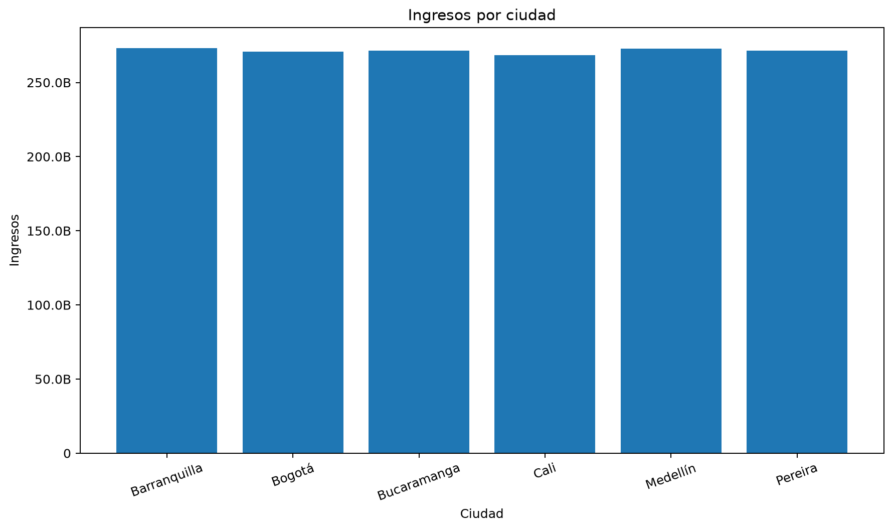
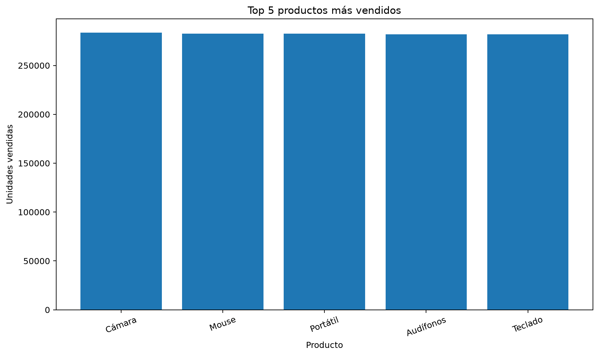
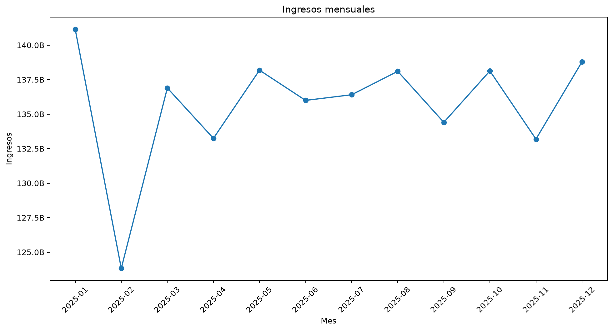
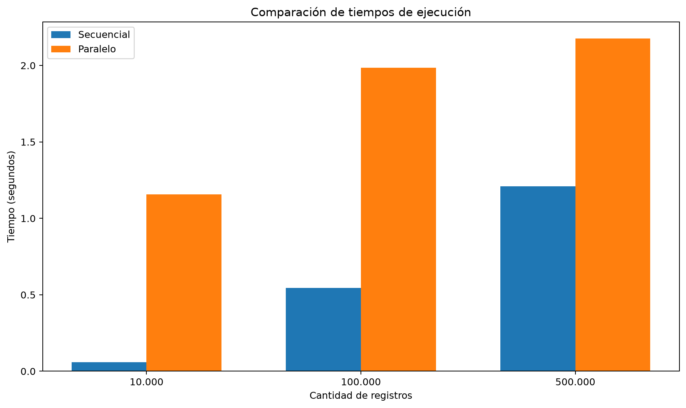
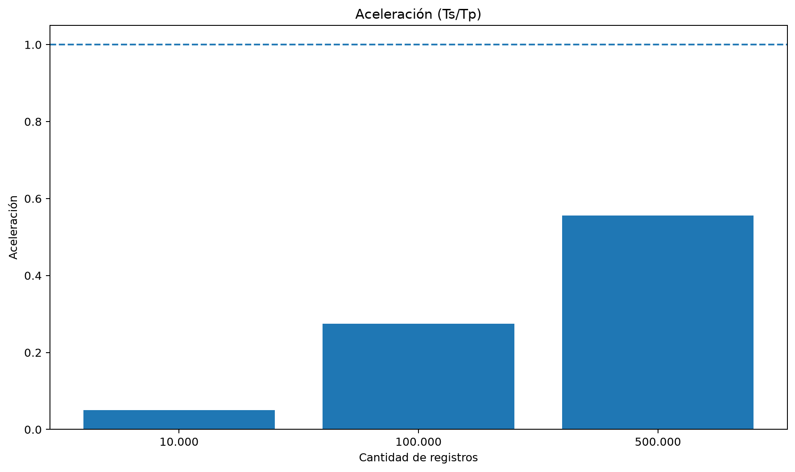

# Guía 8 – Procesamiento Distribuido de Datos

**Universidad Manuela Beltrán (UMB)**  
**Módulo:** Gestión de Recursos y Tolerancia a Fallos  
**Tema:** Procesamiento Distribuido de Datos  
**Guía:** 8 – Semanas 14 a 16

## Descripción del proyecto

Este proyecto consiste en una aplicación desarrollada en Python que permite analizar registros de ventas de una empresa comercial mediante procesamiento secuencial y paralelo.

El objetivo es comprender cómo se pueden dividir grandes cantidades de información en diferentes procesos, realizar cálculos y consolidar los resultados para analizar el rendimiento.

Para desarrollar la actividad se utilizaron datos de ventas simulados de diferentes ciudades de Colombia.

La aplicación compara ambos métodos de procesamiento y genera automáticamente archivos CSV, resultados y gráficas.

**Nota:** Se utiliza una simulación de procesamiento paralelo con procesos independientes en un mismo computador. No se implementa un clúster distribuido real.

## Objetivos

- Implementar una solución para procesar grandes volúmenes de datos.
- Comparar el procesamiento secuencial y paralelo.
- Calcular los ingresos por ciudad y por mes.
- Identificar los cinco productos más vendidos.
- Generar gráficas a partir de los resultados.
- Evaluar el rendimiento de la aplicación utilizando diferentes cantidades de registros.

## Tecnologías utilizadas

- Python 3
- Matplotlib
- CSV y JSON
- `concurrent.futures.ProcessPoolExecutor`
- Visual Studio Code
- Git y GitHub

## Estructura del proyecto

```text
Guia8-Procesamiento-Distribuido/
│
├── codigo/
│   ├── generar_datos.py
│   └── procesar.py
│
├── datos/
│   └── ventas_10000.csv
│
├── resultados/
│   ├── comparativa_tiempos.csv
│   ├── ingresos_ciudad.csv
│   ├── ingresos_mensuales.csv
│   ├── productos_top5.csv
│   └── resultados_completos.json
│
├── graficas/
│   ├── 01_ingresos_por_ciudad.png
│   ├── 02_top5_productos.png
│   ├── 03_ingresos_mensuales.png
│   ├── 04_comparacion_tiempos.png
│   └── 05_aceleracion.png
│
├── requirements.txt
├── .gitignore
└── README.md
```

Los archivos de 100.000 y 500.000 registros se generan localmente para evitar subir archivos demasiado grandes al repositorio.

## Instalación y ejecución

**1. Descargar el proyecto**

Clonar el repositorio desde GitHub o descargarlo como archivo ZIP.

**2. Abrir el proyecto**

Abrir la carpeta descargada en Visual Studio Code.

**3. Instalar dependencias**

En la terminal ejecutar:

```bash
python -m pip install -r requirements.txt
```

**4. Generar los datos de ventas**

```bash
python codigo/generar_datos.py
```

El programa genera automáticamente tres archivos:

- `ventas_10000.csv`
- `ventas_100000.csv`
- `ventas_500000.csv`

**5. Ejecutar el procesamiento**

```bash
python codigo/procesar.py --procesos 3
```

La aplicación realiza las pruebas utilizando tres procesos independientes y compara los resultados obtenidos con el procesamiento secuencial.

## Funcionalidades principales

La aplicación permite:

1. Generar datos de ventas ficticios.
2. Dividir los registros en particiones.
3. Procesar las particiones mediante procesos independientes.
4. Consolidar los resultados.
5. Calcular ingresos por ciudad.
6. Identificar los cinco productos con mayores ventas por cantidad.
7. Calcular ingresos mensuales.
8. Comparar los tiempos de ejecución.
9. Verificar que los resultados secuenciales y paralelos coincidan.
10. Generar automáticamente cinco gráficas en formato PNG.

## Resultados de las pruebas

Se realizaron pruebas con 10.000, 100.000 y 500.000 registros.

| Registros | Tiempo secuencial | Tiempo paralelo | Aceleración |
|---|---|---|---|
| 10.000 | 0,05882 s | 1,15595 s | 0,051 |
| 100.000 | 0,54497 s | 1,98550 s | 0,275 |
| 500.000 | 1,20866 s | 2,17595 s | 0,555 |

En las tres pruebas los resultados coincidieron.

En este caso, el procesamiento secuencial fue más rápido que el paralelo, debido al costo adicional que implica crear procesos, distribuir las tareas y consolidar los resultados.

Estos tiempos corresponden a una ejecución realizada en Windows con un procesador Intel Core 5 120U, 12 procesadores lógicos y aproximadamente 24 GB de RAM. Pueden variar al ejecutar el programa en otros computadores.

## Gráficas generadas

Las gráficas se crean automáticamente cada vez que se ejecuta el procesamiento.

### 1. Ingresos por ciudad



Permite comparar los ingresos obtenidos en las diferentes ciudades.

### 2. Cinco productos más vendidos



Muestra los productos con mayores ventas en cantidad de unidades.

### 3. Ingresos mensuales



Permite observar cómo se distribuyen los ingresos durante los meses del año.

### 4. Comparación de tiempos



Compara los tiempos de ejecución secuencial y paralelo para cada conjunto de datos.

### 5. Aceleración del procesamiento



Muestra la relación entre el tiempo secuencial y el paralelo.

Una aceleración superior a 1 indica una mejora de rendimiento mediante procesamiento paralelo.

## Conclusiones

El desarrollo de esta actividad permitió comprender cómo funciona el procesamiento paralelo y cómo pueden dividirse los datos para ejecutar tareas independientes.

Se comprobó que los resultados obtenidos por ambos métodos fueron iguales, lo que demuestra que la división y consolidación de registros funcionó correctamente en las pruebas realizadas.

También se observó que utilizar varios procesos no garantiza una ejecución más rápida, ya que intervienen factores como el tamaño de los datos y el tiempo necesario para coordinar los procesos.

Finalmente, la aplicación permitió visualizar los resultados de ventas mediante gráficas y comprender la importancia de medir el rendimiento antes de seleccionar una estrategia de procesamiento.

## Integrantes

- Jeslly Tellez
- Laura Espejo 

**Universidad Manuela Beltrán – Ingeniería de Software**  
**Año:** 2026
